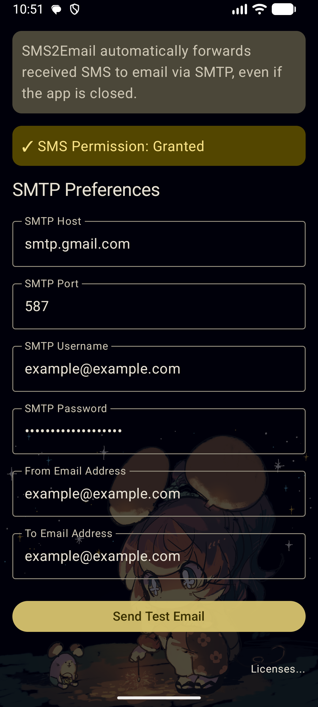

# SMS2Email

An Android application that forwards incoming SMS messages from selected SIM slots to configurable email senders and Matrix rooms through the official Matrix Android SDK.

Each SIM input and sender can be enabled or disabled independently. This app is useful for users who need to access their SMS messages remotely.

| 🌙                                                                        | ☀️                                                                         |
| ------------------------------------------------------------------------- | -------------------------------------------------------------------------- |
|  |  |

## Configuration

Grant SMS and SIM-identification permissions, then select the SIM slots that should trigger forwarding. Add any number of enabled email or Matrix senders. Each email sender has its own SMTP host, port, OAuth token, encryption mode, sender address, and recipient. Matrix uses the official `matrix-android-sdk2` client and requires a Matrix user ID, access token, homeserver URL, and joined room ID.

Release builds are split into `arm64-v8a` and `armeabi-v7a` APKs to keep each download small.

