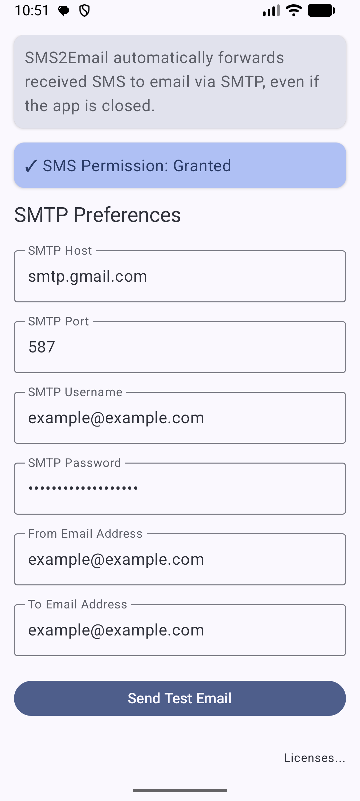

# SMS2Email

An Android application that forwards incoming SMS messages to a specified email address.

This app is useful for users who need to access their SMS messages remotely.

## OpenPGP encryption

Each email account can sign and encrypt forwarded SMS end to end with [OpenKeychain](https://f-droid.org/packages/org.sufficientlysecure.keychain/), so mail servers on the way can neither read nor fake them.

1. Install OpenKeychain on the phone. Import the recipient's public key, and create or import a key for the phone to sign with.
2. In SMS2Email, turn on **Sign and encrypt with OpenKeychain** for the email account.
3. Choose the recipient key and the signing key once; both are saved with the account.
4. Tap **Check encryption**. Allow SMS2Email in OpenKeychain, and enter the signing key's passphrase if it has one.

Emails use PGP/MIME (RFC 3156), which Thunderbird and Thunderbird for Android with OpenKeychain decrypt and verify automatically. The subject is always `SMS`; the sender, time, SIM and text are only inside the encrypted part. If OpenKeychain cannot sign and encrypt, the email is not sent. OpenKeychain remembers a passphrase only for a while, so a signing key made just for the phone, without a passphrase, keeps forwarding working unattended.

| 🌙                                                                        | ☀️                                                                         |
| ------------------------------------------------------------------------- | -------------------------------------------------------------------------- |
|  |  |

